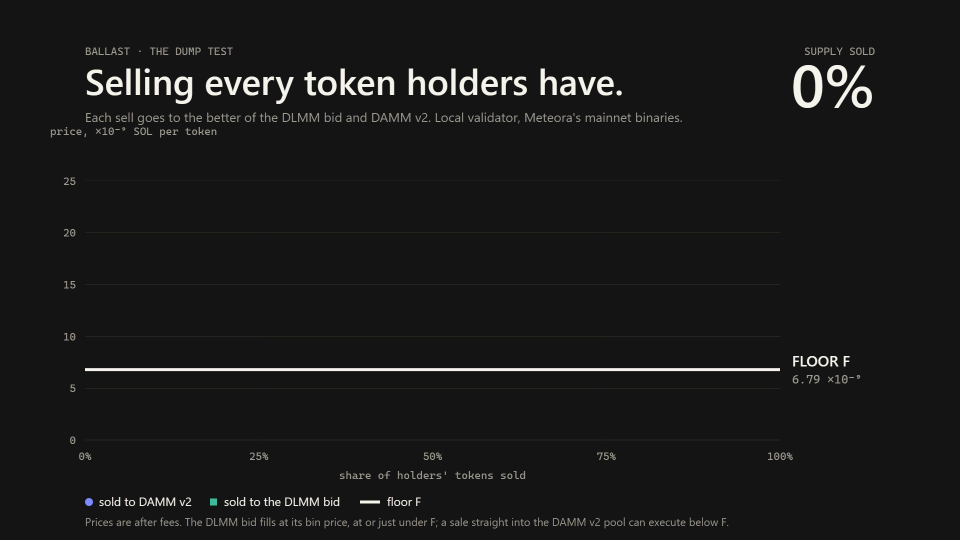
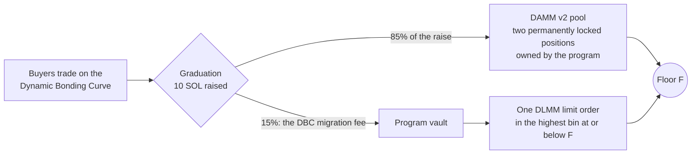

# Ballast

**Launch with a floor.**

A Meteora token launch whose worst case is computed on-chain before the first public trade, and
verifiable by anyone.

[](https://github.com/SamarthSrivastavaa/ballast/actions/workflows/ci.yml)
[](https://github.com/SamarthSrivastavaa/ballast/issues?q=label%3Averified)
[](https://github.com/SamarthSrivastavaa/ballast/issues?q=label%3Alaunch-request)
[](https://github.com/SamarthSrivastavaa/ballast/issues?q=label%3Abreak-attempt)

**This is an executable buyback floor on Meteora, not a promise about prices elsewhere.**

**▶ [Watch the 3-minute demo](submission/video/ballast-demo.mp4)** · [For judges](JUDGES.md) · [Hard questions, answered](submission/JUDGE_FAQ.md)



*Every token holders had, sold on Meteora's mainnet binaries (local validator). The worst fill of
the whole sell-out was 0.998 × F, fees included.*

- **Buyers:** see your worst case before you buy.
- **Creators:** launch without being called a rug.
- **Launchpads:** offer a launch class with a verifiable floor, with one DBC config and one instruction.

## Try to break it

Check the locked-liquidity floor under **any Meteora DAMM v2 pool on mainnet**, in one command:

```bash
curl -fsSL https://raw.githubusercontent.com/SamarthSrivastavaa/ballast/main/install.sh | sh
./ballast check <DAMM v2 pool address> --cluster mainnet
```

```
RESULT: LOCKED-LIQUIDITY FLOOR ✓  F = … per token = …% of the pool price (worst case from here: −…%)
RESULT: NO FLOOR ✗  nothing in this pool is permanently locked; its liquidity can be withdrawn
```

Verify a Ballast launch the same way; it recomputes everything from raw accounts and never calls our
app or any API of ours:

```bash
./ballast verify <mint> --cluster <mainnet|devnet|local>
# … 16 checks …
# RESULT: FLOOR VERIFIED ✓  F = 6.8400e-9 SOL/token (predicted 6.7019e-9 at slot 12988)
```

No prebuilt binary for your machine? `cargo install --git https://github.com/SamarthSrivastavaa/ballast ballast-verifier --locked`.

Ran it? [Post your output](https://github.com/SamarthSrivastavaa/ballast/issues/new?template=i-verified.yml).
Think you can make the floor fall? [The challenge and its rules](submission/BREAK_THE_FLOOR.md).
Want to launch with it? [Request a launch](https://github.com/SamarthSrivastavaa/ballast/issues/new?template=request-launch.yml).

## How it works



At graduation, 85% of the raise migrates into DAMM v2 as two permanently locked, program-owned
positions; the other 15%, the DBC migration fee, lands in a program vault and rests as one DLMM limit
order in the highest bin at or below F. **F is the price at which that locked liquidity plus that bid
absorb the entire outstanding supply:**

```
V/F + L·(1/√F − 1/√P_max) = S          V = vault quote · L = permanently locked liquidity · S = outstanding supply
```

F is recorded on-chain in the pool-creation transaction, before anyone but the launcher can trade.
The realised F must be at or above that prediction, and every instruction that changes V, S or L ends
with an on-chain check that F did not fall. Fills on the bid are burned, which raises F for everyone
who remains. A holder can also redeem with the program at F less 0.5%; the 0.5% stays in the vault.

| Meteora product | Its part of the floor |
|---|---|
| **DBC** (Dynamic Bonding Curve) | The launch class: the config is validated field by field on-chain; the prediction is recorded at registration; the 15% migration fee funds the vault |
| **DAMM v2** | 85% of the raise in two permanently locked positions owned by program PDAs: L in the equation |
| **DLMM** | The vault as one limit order at the floor: V in the equation. Fills are settled by cancel → burn → re-place |

**Why this needs all three:** a migration fee to fund the vault (DBC), liquidity that can never be
withdrawn (DAMM v2's permanent locks) and a resting order a program can own (DLMM limit orders).
Together they let a floor be enforced by liquidity instead of promised by a team.

## Proof

We bought a launch to graduation, then sold every token holders had. Run of 11 Oct 2026:

| Claim | Result |
|---|---|
| Predicted F, recorded before the first public trade | 6.7019e-9 SOL/token |
| Realised F at open | 6.7919e-9 (+1.34%: at or above the prediction) |
| Full sell-out | 73 sells: 38 into the DLMM bid, 35 into DAMM v2; 100% of holders' tokens |
| **Worst fill of the whole sell-out** | **0.9984 × F, fees included** (the last sell, into the pool) |
| Fills on the DLMM bid | 0.9994 × F or better |
| Vault after the sell-out | 0.00006 SOL left of 1.54: the bid sold out |
| F after the sell-out | 6.8400e-9: higher than at open |
| The vault's ledger, rebuilt from chain data | closes to the lamport |
| 200 random transactions on a second launch | F never fell |
| `ballast verify` | 16 of 16 checks pass |

**Where this ran, exactly:**

| Cluster | State |
|---|---|
| **Local validator running Meteora's mainnet DBC, DAMM v2 and DLMM binaries**, dumped from mainnet and pinned by hash | Everything above. Nothing is mocked. Reproduce it with the four commands below |
| **Devnet** | The program is deployed and initialised ([deploy](https://explorer.solana.com/tx/36QzhPaB6KwjTHZFoFc47y2SuqYdnDeWG6ZAitewJmTUdZPWYRgEWpSq3d1ZhWYuewN1WmnSAHq2wd5d57pyeEEW?cluster=devnet), [program](https://explorer.solana.com/address/HSSv351Q1DftJ7mgEzKm9rt41WUTyWZJZLXUq7sfqerr?cluster=devnet)). **No launch exists there**: devnet runs a newer DBC build whose configs carry version 1, and the program refused to create a class from one ([`ConfigWrongVersion`](https://explorer.solana.com/tx/2kPEwtNjwECwh7tSg5TJmWJgRyTaTpte5WN3K6wkfarJuf1dqUBwzQEns4NuMM5z4RJUB8AuZLHgAbqABKrRJVNB?cluster=devnet)). That is the config check doing its job |
| **Mainnet** | **Not deployed.** `ballast check` and `ballast scan` read mainnet today |

The launch's accounts and transactions live on the local ledger, so they have no public explorer
links; every run regenerates them. From the 11 Oct run
([`evidence/proof-local/summary.md`](evidence/proof-local/summary.md) has every signature):

| What | Address or signature (local ledger) |
|---|---|
| Ballast program | `HSSv351Q1DftJ7mgEzKm9rt41WUTyWZJZLXUq7sfqerr` |
| Token mint | `7pGEqAUtATUkWJkkCt5mAoPuuW7M9YhRx3UAaH9N1rry` |
| Launch account | `2rbW5eaBUkYmsbX38X53vzggmoHenGJn3LJMREdxyiDy` |
| Class | `t4HGJHkV2GQ9dLiQyT7an88ZWkgrBtc5eTPiqiQJ5BG` |
| DBC pool | `4LRgsWWCKy4AGSnQiyqzcXZtK3i1XRo3HDZygcxLNhxY` |
| DAMM v2 pool | `BJiEPE5KVywcoYVag941cM2c151F6X6SpaiebFJ4pQkN` |
| Locked positions | `3fC9c2HLvqzTbWTpkaWeZNCTHvHdEp4m3bPikAowwJaz`, `EQShRPNpdPFouDYQQYY4sKQkMNhCq9fJGFDZxPqYyQaZ` |
| Vault (PDA) | `3VeSUxczZukeo6CNNNZf6aLdMr6oPmZvTEsG83PHXnz3` |
| DLMM pair (bin step 10; the vault rests in it as one limit order) | `EQM11DsypubNZWZam4AACMF9qze2dPhZGzaUmPFDXcwD` |
| Limit order | `FFuwF4q5ZJPwpZE7n2eGKhJJktiTehzvowZjA2BAGLTP` (bin −11906) |
| Prediction transaction (the launch) | `5RZTfviZMrvKCeJxwmKgDb99mGi65AfysSJd5XQZ1SiwiHnRSCysJAu4a68DTyyuMsFij8KcR7Kw8zrBfishh3oS` |
| Graduation: fee to the vault | `4SGMtfdZdW5GGPtcGfa7Ccd9koLMxGzvHhz6hyd9ExfKXywLCce8i4TKHJaGgtgAw5YPeKs5YFrdGKAhpdFLoPdf` |
| Graduation: migration to DAMM v2 | `uPrEMwC5s5RBqCb8FtoQNcwEyu8XJ7iV1Vbt3nKJL6hqQKPEWy5SG8qkooSW1viZ6rGjxoRXq6WBTC85TKz1tM5` |
| Floor: the limit order placed | `3j3W2RGh3LXFziMzN5uKJTTh2kRQ7ycZPuBjq7J9PnHpBE8x17EfwPz4hsD8W8Ej1zEioo8tXNHCeZbmsrkXoeab` |
| Dump: first fill on the bid | `4ChdeaEAtWqEkGht4Vg11wuDbMrCR4bC3yyzZA5BVwAqtHHFafZh141i4Vexscr9w2PfuTwEsjpLYsJr7jV5fT69` |
| Dump: last sell | `A5kqaPboe1DSjAwQ7BFzFTcHJQB6aWz8Bz8UkN7fMb9uqGRmRdhyndefpypT8wTjzSrnV4pSKnV2ZmGCtbZmTqf` |
| Verifier output | [`evidence/proof-local/verify.txt`](evidence/proof-local/verify.txt) |

Reproduce all of it (toolchain in `docs/operations.md`):

```bash
pnpm fixtures:check && pnpm localnet --quiet &      # Meteora's mainnet binaries, hashes checked against mainnet
bash tests/integration/p0/up.sh && anchor build
pnpm proof:local                                    # the whole lifecycle and every gate, about 20 minutes
pnpm demo:all                                       # the same launch as a step-by-step runbook with a chart
```

**Why it matters.** `ballast scan` over the 100 newest DBC → DAMM v2 launches on mainnet (8 Oct
2026): 94 had no permanently locked liquidity at all, and only 2 held a locked-liquidity floor above
half their pool price ([data](evidence/scanner/scan-100-2026-10-08.json)).

## Engineering

- **One implementation of F.** [`crates/floor`](crates/floor) is the only code that computes F: exact
  integers, no floating point, rounding always toward the protocol. The on-chain program, the
  verifier and the web page (through a WebAssembly build of the same crate) all call it.
- **34 tests and a 100,000-case property gate** on that crate, in CI. An independent integer reference
  in Python ([`tests/reference/floor.py`](tests/reference/floor.py)) agrees with the Rust crate and
  its WebAssembly build on 10,014 published vectors, bit for bit.
- **The program:** 12 instructions. The vault has exactly two exits: the DLMM bid it owns, and a
  redeemer burning tokens in the same instruction. There is no withdraw instruction.
- **Tested against the real thing:** 167 program tests run on Meteora's mainnet binaries, with one
  negative test per substituted account. A model fuzzer ran 10 million steps with no failure.
- **A verifier that shares nothing with the app:** it re-derives the prediction from the DBC config
  with its own code, rebuilds the floor's whole history from program events, and reconciles the
  vault's ledger to the lamport.
- **A token page** that shows the floor only when the on-chain view and the WebAssembly floor crate
  agree on the same live accounts ([`app/`](app), screenshots in [`evidence/app/`](evidence/app)).

Details: [`docs/mechanism.md`](docs/mechanism.md) · [`docs/math.md`](docs/math.md) ·
[`docs/meteora.md`](docs/meteora.md) · [`docs/architecture.md`](docs/architecture.md) ·
[`docs/verifier.md`](docs/verifier.md) · [`docs/proof.md`](docs/proof.md) ·
[`docs/security.md`](docs/security.md).

## Integrate in your launchpad

One DBC config (already validated on-chain as a Ballast class) and **one instruction**,
`register_launch`, in your launch transaction next to Meteora's own pool creation. Everything after
that is a permissionless crank the open-source keeper sends. Real code:
[`docs/INTEGRATE.md`](docs/INTEGRATE.md).

## Limitations

- **Late buyers can lose about 74%.** The floor sits at about 26% of the graduation price. It tells
  you your worst case; it does not make it small.
- **F is in SOL, not dollars.**
- **Each number is one of six prices, and they differ:** the theoretical floor F; the bid's bin price
  (at or below F, within one 0.1% bin); what you receive from the bid after DLMM's fee; the DAMM v2
  price; what you receive from the pool after its 1% fee; and redemption (F less 0.5%).
- **Selling straight into the DAMM v2 pool can execute below F.** After a full sell-out the pool
  price sits just under F and the pool charges 1%. The bid fills at its bin price and redemption pays
  F less 0.5%; neither depends on the pool price. Reaching the best price means routing between the
  two venues, as an aggregator does.
- **Not audited.** Two internal reviews found no critical or high issue; no outside firm has looked.
- **Upgrade authority:** the program has no instruction that withdraws the vault or the locked
  positions, but it is upgradeable. The authority is a single project key
  (`F1s4kPpt…GrUT1` on devnet) until an audit; it is not a multisig and not revoked.
- **Not on mainnet, and no launch on devnet.** See "Where this ran".
- **No real users yet.** Every wallet in the proof is a test wallet.
- **Dependencies on Meteora:** if the DLMM pair is disabled by its operator, the bid and redemption
  pause; the locked pool still works. A new DBC config version needs a program upgrade before new
  classes can be created.
- **A third party can hold the DLMM bid below F's bin** by pinning the pair's active bin. Within 70
  bins the bid is capped there; further down it is suspended. Redemption still pays F less 0.5%.

Everything else, with evidence: [`docs/limitations.md`](docs/limitations.md).

## Roadmap

1. An external audit; upgrade authority to a multisig, then frozen.
2. Mainnet: the Proof launch, then a public launch.
3. Launchpad integrations: Ballast as a launch class any DBC launchpad can offer.
4. Support for the next DBC config version.

## Team

⟦FILL: name, role, one line of background, contact⟧. Built in India.

## Repository

```
programs/ballast/        the on-chain program
crates/floor/            the floor crate (the only implementation of F) and its vectors
crates/verifier-core/    account fetch and checks      verifier/   the `ballast` CLI
sdk/typescript/          client, PDAs, the floor crate through WebAssembly
keeper/                  permissionless cranks         app/        landing page and token page
demo/                    the step-by-step runbook      scripts/    proof, mainnet dry run, fixtures
evidence/                every run's output            submission/ challenge, outreach, submissions
```

```bash
cargo fmt --all --check && cargo clippy --all-targets -- -D warnings
cargo test --workspace && python3 tests/reference/floor.py
```

For judges: [`JUDGES.md`](JUDGES.md) · [`submission/JUDGE_FAQ.md`](submission/JUDGE_FAQ.md).
Build log and decisions: [`STATUS.md`](STATUS.md), [`DECISIONS.md`](DECISIONS.md).
License: [Apache-2.0](LICENSE).
